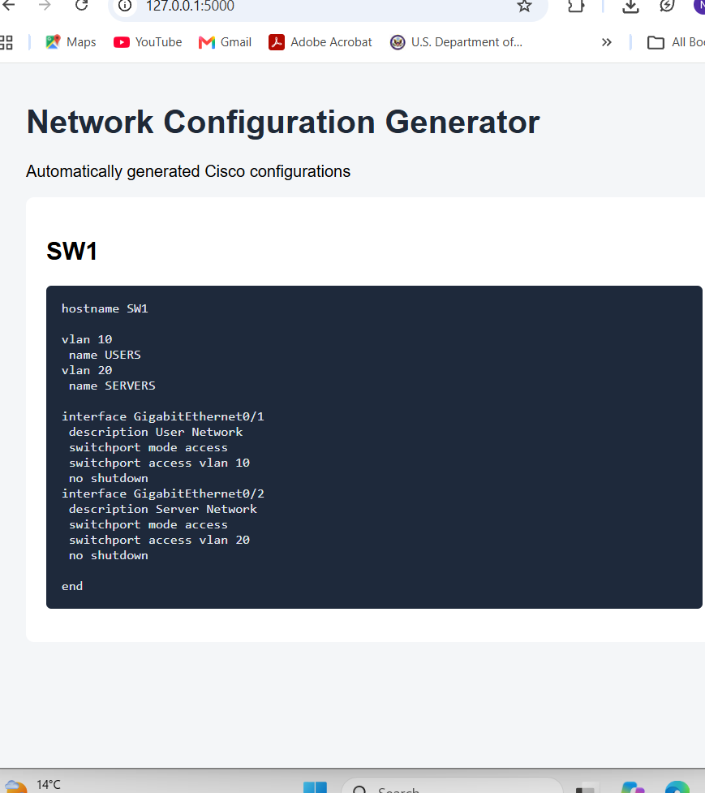

# Network Configuration Automation

A Python-based network automation project that generates Cisco IOS configurations from YAML inventory files using Jinja2 templates. It includes a Flask web application, REST API, inventory validation, automated testing, and optional SSH deployment using Netmiko.

## Project Overview

This project demonstrates how network configuration tasks can be automated using Python. Instead of manually writing repetitive Cisco switch configurations, users can define device details, VLANs, and interfaces in a YAML inventory file and generate configurations automatically.

## Key Features

- YAML-based network device inventory
- Automated Cisco IOS configuration generation
- Jinja2-based configuration templates
- Inventory validation for device names, hostnames, VLAN IDs, and interfaces
- Flask web application for viewing configurations
- REST API for retrieving device information and configurations
- Netmiko-based SSH deployment support
- Dry-run mode enabled by default
- Explicit confirmation before deployment
- Automated unit testing using Python unittest

## Technologies Used

| Technology | Purpose |
|---|---|
| Python 3.11 | Core automation logic |
| PyYAML | Reading YAML inventory |
| Jinja2 | Cisco configuration templates |
| Flask | Web application and REST API |
| Netmiko | SSH-based network device interaction |
| python-dotenv | Environment variable management |
| unittest | Automated testing |

## Project Architecture

```text
       YAML Inventory
              |
              v
    Inventory Validation
              |
              v
   Python Configuration Generator
              |
              v
       Jinja2 Template
              |
              v
    Generated Cisco IOS Config
              |
        +-----+-----+
        |           |
        v           v
   Flask Web     Netmiko
   Interface     Deployment
   REST API      (Optional)
```

## Project Structure

```text
network-config-automation/
│
├── templates/
│   └── cisco_ios.j2
│
├── tests/
│   ├── test_app.py
│   └── test_config_generator.py
│
├── app.py
├── config_generator.py
├── deploy.py
├── inventory.yml
├── requirements.txt
├── .env.example
├── .gitignore
└── README.md
```

## Installation

Clone the repository:

```bash
git clone https://github.com/nithya-ramalingam/network-config-automation.git
```

Navigate into the project:

```bash
cd network-config-automation
```

Create a virtual environment:

```bash
python -m venv .venv
```

Activate it on Windows PowerShell:

```powershell
.\.venv\Scripts\Activate.ps1
```

Install dependencies:

```bash
python -m pip install -r requirements.txt
```

## Generate Cisco Configurations

Run:

```bash
python config_generator.py
```

The application reads the YAML inventory, validates device information, and generates Cisco IOS configuration commands.

## Run the Flask Application

Start the web application:

```bash
python app.py
```

Open the application:

http://127.0.0.1:5000

## REST API Endpoints

| Endpoint | Description |
|---|---|
| `/` | Web interface |
| `/api/devices` | Retrieve available devices |
| `/api/config/SW1` | Retrieve SW1 configuration |

Example API request:

```text
http://127.0.0.1:5000/api/config/SW1
```

## Automated Testing

Run all tests:

```bash
python -m unittest discover -s tests -v
```

The test suite covers:

- Configuration generation
- Hostname generation
- VLAN configuration
- Interface configuration
- Flask homepage
- Device API
- Configuration API
- Invalid inventory data
- Duplicate device names
- Invalid VLAN IDs

**Current test result: 12 tests passing.**

## Optional Network Deployment

The deployment script supports Netmiko-based SSH configuration deployment.

By default, the script runs in dry-run mode:

```bash
python deploy.py
```

For an authorized lab device, optional deployment can be requested using:

```bash
python deploy.py --apply
```

The deployment process requires credentials configured through environment variables and explicit confirmation before attempting to connect.

**Important:** Actual SSH deployment has not yet been tested against a physical or virtual network device.

## Security and Safety

- Credentials are loaded through environment variables.
- `.env` files are excluded from Git.
- Dry-run mode is enabled by default.
- Deployment requires explicit confirmation.
- Only deploy to network devices you are authorized to manage.
- The sample IP `192.0.2.10` is reserved for documentation and is not a real switch.

## Future Enhancements

- Multi-vendor network device support
- Configuration backup and comparison
- Pre-deployment configuration validation
- Deployment logging and reporting
- Role-based access control
- Integration with network monitoring tools

## Author

**Nithya Ramalingam**

Master of Engineering in Internetworking | Network Operations | Python Automation

[GitHub Profile](https://github.com/nithya-ramalingam)

[Project Repository](https://github.com/nithya-ramalingam/network-config-automation)

## Application Screenshot

